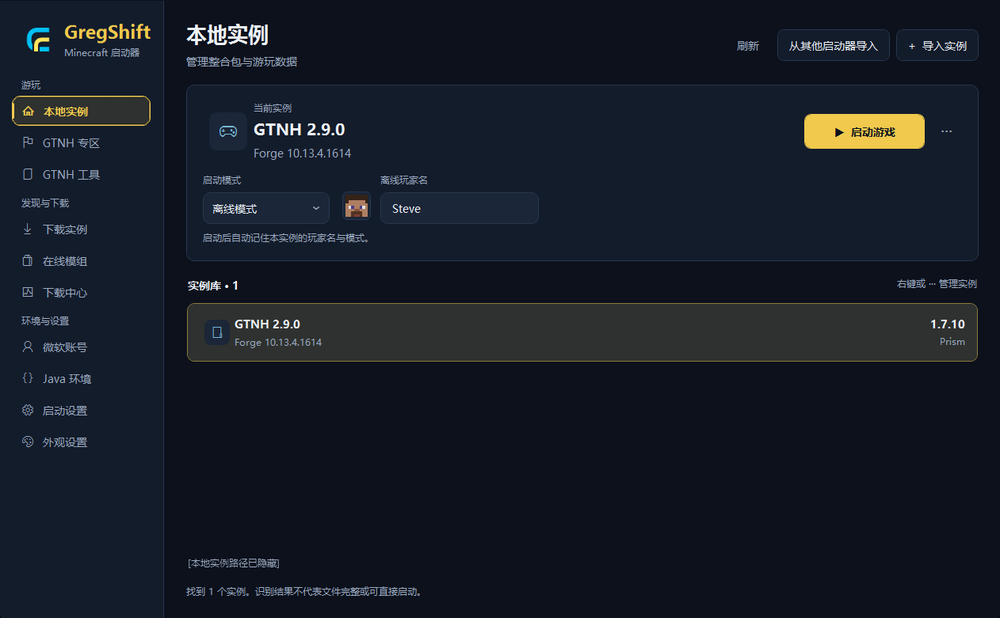
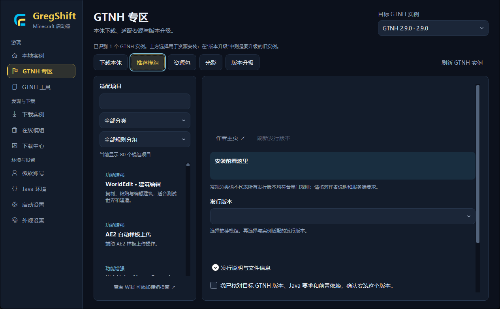

# GregShift

[简体中文](README.md) | English

GregShift, formerly EML, is a Windows launcher built for **GT New Horizons (GTNH) players in China**.

A GTNH playthrough can last through several pack updates. GregShift handles pack installation, Java setup and mod management, and helps move saves, maps and personal settings from an old instance to a new one. Less time moving files around, more time playing.

It also supports other common modpack formats, downloads from Modrinth and CurseForge, and vanilla Minecraft Java Edition. This is an independently maintained third-party project, **not an official GTNH, Mojang or Microsoft launcher**.

**Still in 1.0-RC2 testing.** Not all environments have been verified. This README describes the current source; the published RC2 package may not include later changes. Check the notes for the package you download and the [release guide](docs/release-rc2.md) for upgrade instructions.

The rename does not move existing data. Release packages still start with `EML.exe` in the root, with application files and bundled .NET in `app/`. Instances and settings stay in their existing locations; code projects and some paths still use EML.

## Screenshots

Screenshots are from an earlier Chinese test build and may differ from the current interface. Personal details have been redacted.

GTNH hub: recommended mods

GTNH player-data migration guide

## What you can do

### Install and play

- Download modpacks from Modrinth or CurseForge, or install vanilla Minecraft from Mojang's version catalog. Import Prism ZIPs, Modrinth `.mrpack` files, CurseForge ZIPs and supported game-directory ZIPs; dependency downloads start after import.
- Copy supported instance folders from launchers such as Prism and the Modrinth App without making a ZIP first. The original instance stays in place, and launcher account credentials are not imported.
- Detect installed Java runtimes or download a suitable one from the Java page. If an instance has no compatible Java, GregShift asks before downloading and installing it. Existing Java installations and system environment variables are left alone.
- Add and manage multiple Microsoft accounts, then choose an account or offline mode for each instance. Once the game process starts, GregShift remembers that instance's account, name and mode. Changing the default account does not overwrite an instance's existing choice; authentication failure never silently switches accounts or falls back to offline mode.
- Online mode shows the selected Minecraft name and skin avatar. Offline mode takes a player name and uses a built-in Steve avatar. Avatar loading failures do not block sign-in or launching.
- Set Java, memory and JVM options per instance and view game logs. Java and JVM settings require an explicit save.

### GTNH hub

- Choose a specific Prism/MultiMC client pack from the integrated China-based mirror, then download, import and prepare a new instance.
- Browse categorized mods, resource packs and shaders with Chinese descriptions, source links and compatibility notes. Supported release files can be installed into a selected GTNH instance.
- Start an upgrade from your old instance and choose a newer pack and Java variant in a separate dialog, with test releases available if needed. Confirm to download and prepare it without leaving the upgrade page, then review which player data and extra mods to carry over. Cancelling the dialog starts no download; you do not need to install the newer instance beforehand.

### GTNH tools

- Open the separate tools page directly below the GTNH hub in the sidebar. Search the flowchart catalog and open a chart on its own detail page. Returning keeps your filters and browsing position; uncreated entries stay in the catalog and are marked as pending.
- Flowcharts load declarative data on demand and use a native interactive canvas for zooming, panning, group highlighting and Chinese/English views where supplied by the source. Successfully cached charts work offline. Each cache keeps its source, revision when available, retrieval time and license information; website icons and detailed recipe popups are not included.
- If the wiki rejects direct retrieval, open the original page inside the launcher, wait for it to display normally and explicitly read it into the native chart. The data goes through the same validation before caching; this does not bypass the site's access controls.
- The online quest book remains an embedded website and does not read or sync game progress. The quest book, online catalog updates and explicitly opening the original page need a network connection and WebView2; native charts do not. Chart data keeps its original license, separate from the launcher's GPL. See the [tools guide](docs/gtnh-tools.md).

### Mods and add-ons

- Search Modrinth and CurseForge by Minecraft version, loader and other filters. Mods and modpacks open in separate detail pages with icons, descriptions and releases. Returning to the results keeps your filters and browsing position.
- In online mod search, choose whether to include required dependencies and select optional dependencies individually. Review the installation plan before downloading.
- Add local mods, or explicitly take over untracked extra mods. Enable, disable, move to the recovery area or restore supported managed files. Mods declared by the imported pack remain protected; this is not an unrestricted editor for every file in `mods`.

### Downloads and instance care

- Manage file transfers in one download center: pause, resume, cancel, set queue priority, adjust concurrency and cap total bandwidth. Compatible downloads can reuse verified cache entries or resume partial transfers when the source supports it.
- Check cache usage in download settings and confirm cleanup of unused complete entries and diagnostic copies. Manual cleanup keeps resumable fragments and does not delete instances, original pack archives or backups.
- Find instances in the launcher's `instances/` folder, inspect their details, rename or delete them, or export a ZIP backup. Right-click an instance or use the “···” beside the launch button for its management tools.
- Run quick or full integrity checks that account for file sources, accepted user changes and recorded mod enable/disable/removal choices. Normal launches check essential startup requirements without hashing the whole pack again. Export checks use the current import limits before publishing a backup.

### Interface and appearance

- Choose dark, light or the Windows app theme, with custom accent and background colors.
- Use a local PNG or JPG/JPEG wallpaper and adjust its overlay. Only static images are supported, not video. Inputs, menus and dialogs keep solid backgrounds for readability.
- Buttons, navigation and page transitions have subtle hover, press and transition effects that respect Windows animation and high-contrast settings. Startup scans update page status without result popups.

Appearance settings are saved locally. See the [appearance guide](docs/appearance.md). The app currently uses a mainly Chinese interface; this English README does not mean a full English UI is available.

## Moving to a newer GTNH version

In the GTNH hub, open version upgrading and select **the old instance containing your player data**. You do not need to have the new version installed yet.

If the old instance is still in another launcher, copy a supported folder with “Import from another launcher,” or export it and use “Import old instance (with local data)” in the GTNH hub. The folder or archive must actually contain your saves and maps; downloading the original pack again will not recover your play history.

Choose a higher-version Prism client pack and Java variant in the version-selection dialog. Confirm to download, import and prepare a **separate new instance** while staying on the upgrade page. If you already have a prepared newer instance, the local-instance option is still available. Test-launch the new version, exit normally and close both games before continuing to the data selection and file preview:

- Worlds, NEI records, JourneyMap maps, ore-vein and Thaumcraft-node data, selected personal settings and server lists.
- A server-player preset for local client data, without copying a server world.
- Your language preference and individually selected extra mods. All extra mods are unchecked by default and require a separate risk confirmation. Entries distinguish recorded additions from files whose origin you must confirm; a bundled Prism mod is not automatically treated as a player addition. Existing duplicates in the new version stay in place. Selected old mod files are copied as-is, without updating them or installing dependencies.

GregShift leaves the old instance's game files intact and backs up destination files before changing them. Conflicting worlds are kept in separate folders rather than merged. The last migration can be undone when its recovery conditions still hold; recovery refuses to overwrite files changed afterwards.

**This upgrades a GTNH client and carries over selected data; it does not upgrade a server.** It preserves your language preference, not an old Chinese translation pack. Completion means the data has been copied and still needs a trial run, not that the world or extra mods are compatible. Follow GTNH's update guidance and verify your saves when moving between major versions. See the [migration guide](docs/gtnh-player-data-migration.md) for supported files and recovery details.

## Getting started

1. Extract the Windows x64 package in full to a folder you can write to, then run `EML.exe` from the root. Do not run it inside an archive viewer or copy only the EXE. The launcher includes its required .NET runtime; Visual Studio and the .NET SDK are not needed. Java is separate.
2. Download a pack from the GTNH hub or “Download instances,” or import a local archive. Wait for preparation to finish and resolve any files marked for manual handling.
3. Detect or download Java on the Java page. For online mode, sign in on the Microsoft account page first. In launch settings, choose the identity, Java, memory and JVM options for the instance. Online play requires the relevant game entitlement, service access and a network connection; offline mode does not replace that authentication.
4. Launch the game. If it fails, check the reported reason and runtime logs before changing files.

Before upgrading or uninstalling, stop the game and launcher tasks, close GregShift, and back up the data you need **outside the application folder**. That folder may contain worlds, maps and migration backups. An exported instance ZIP is not a replacement for a full launcher-folder backup. Follow the [upgrade guide](docs/release-rc2.md) or [uninstallation guide](docs/uninstall.md).

## Current status and limits

- RC2 is a test release, not a promise that every pack and PC works. See the [RC2 release guide](docs/release-rc2.md) for testing boundaries and acceptance steps, and the [RC1 verification notes](docs/release-rc1-verification.md) for historical results. Clean-machine and full end-to-end testing are not complete.
- Some platform files require manual handling. For eligible CurseForge mod files without a direct download, GregShift tries a Modrinth file with the same official SHA-1 and size, not a similarly named mod or a different version.
- The GTNH catalog is not a guarantee of compatibility or automatic installation. Some entries open an author page, and recommended-project dependencies are not installed automatically. Resource packs and shaders still need to be enabled in-game.
- GTNH mirror archives currently have no official-hash verification. See the [GTNH hub guide](docs/gtnh-hub.md) for the checks that are performed.
- Chinese names and summaries cover selected mods. Modpack descriptions retain Chinese text supplied through the platform API; English-only descriptions remain in English. GregShift does not automatically translate every project.
- Pack and loader support depends on available metadata and implemented installers. Completing a download or exporting a ZIP does not prove that the game will launch; shared dependencies outside an instance are not included in its ZIP export.

## Documentation

Feature guides are currently in Chinese:

- [GTNH hub](docs/gtnh-hub.md) · [Player-data migration](docs/gtnh-player-data-migration.md) · [GTNH tools](docs/gtnh-tools.md)
- [Instance downloads](docs/instance-downloads.md) · [Download center](docs/download-center.md)
- [Online mods](docs/online-mod-management.md) · [Local mod management](docs/local-mod-management.md)
- [Java downloads](docs/java-downloads.md) · [Launch settings](docs/launching.md) · [Microsoft sign-in](docs/microsoft-login.md)
- [Appearance settings](docs/appearance.md) · [Interface and navigation](docs/ui-navigation.md)
- [File integrity](docs/gameplay-file-policy.md) · [Instance backups](docs/instance-backups.md)
- [Importing folders from other launchers](docs/folder-import.md)
- [RC2 release and upgrades](docs/release-rc2.md) · [RC1 historical release](docs/release-rc1.md) · [RC1 verification record](docs/release-rc1-verification.md)

## Contact, privacy and security

Maintainer: **K4ssia**. Contact **[477619464@qq.com](mailto:477619464@qq.com)** for questions, privacy requests or private vulnerability reports. For a bug report, include the launcher and pack versions, Java version, reproduction steps and only the relevant, redacted error details. Do not send credential files, tokens, full private logs or instances, or post sensitive vulnerability details publicly.

Instances, settings and account credentials are stored locally. Sign-in, search, skin avatars, project icons and downloads connect to the relevant third-party services. There is currently no maintainer-operated data collection server, donation service or separate feedback platform.

[Privacy](PRIVACY.md) · [Security reporting](SECURITY.md) · [Uninstallation and keeping player data](docs/uninstall.md). These documents include English summaries; some still use the former name EML.

## License

GregShift is licensed under the **GNU General Public License, version 3 or any later version (`GPL-3.0-or-later`)**. See [LICENSE](LICENSE).

Minecraft, modpacks, mods, resource packs, Java and other third-party components retain their own licenses and terms.

## Code signing policy

The current `1.0-RC2` package and earlier RC1 packages are **unsigned**. The SignPath Foundation application was not approved, and no signing service is active. GitHub Actions runs build and test checks, not code signing. **K4ssia** is responsible for code review and signing approval; see the [code signing policy](docs/code-signing.md) for the current status and planned controls.
