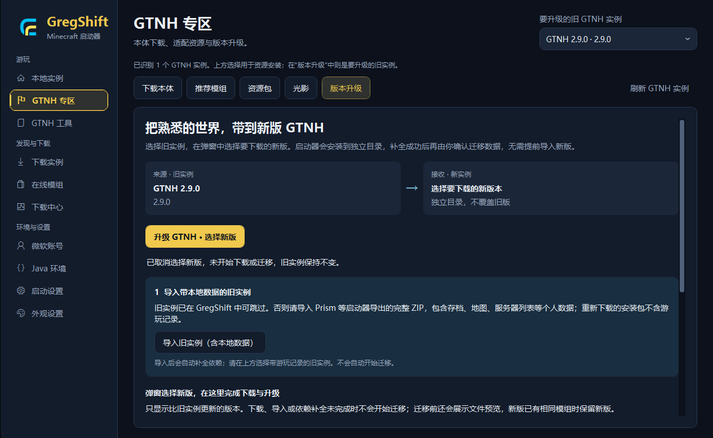
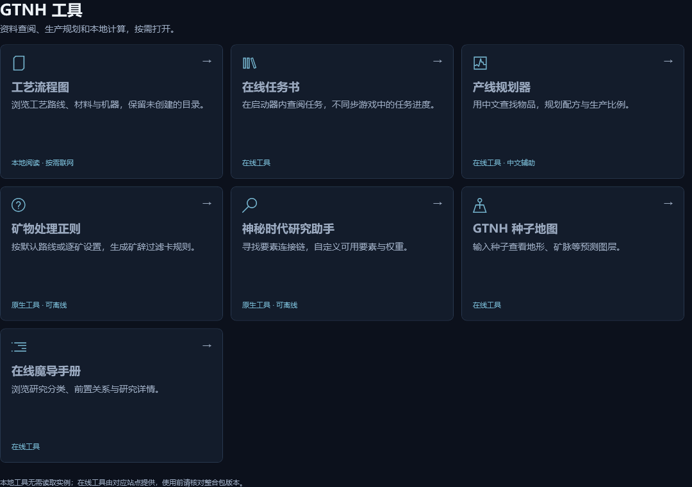

# GregShift

**A Windows launcher for GT New Horizons (GTNH) players in China.**

[简体中文](README.md) | English · [Test releases](https://github.com/Ph1lK4/GregShift/releases) · [Documentation](#documentation) · [Report an issue](https://github.com/Ph1lK4/GregShift/issues)

A GTNH world can outlast several pack versions. When an update arrives, your saves, maps and settings are still in the old instance. GregShift handles pack installation, Java setup and launching, then helps carry your local data into a separate, newer instance without another round of moving files by hand.

Formerly EML, the project is maintained by K4ssia. It also supports other common modpacks and vanilla Minecraft Java Edition. **It is not an official GTNH, Mojang or Microsoft launcher.**

> The current version is **1.0-RC3, an unsigned release candidate**, not a stable release. Read the [RC3 release notes](docs/release-rc3.md) and back up your saves before testing or upgrading. The old RC2 download and checksums are retained; it does not include all the features described here.

## Interface preview

The instance library, GTNH recommended mods and upgrade page are screenshots of the running app, with the local path redacted. The tools directory, download center and light-theme previews were rendered off-screen using the current source's actual UI controls and demo data. These images do not establish full online-service or game acceptance testing. The app is currently mainly in Chinese; this English README does not imply an English UI.

GTNH recommended mods, upgrades and tools

Browse by category and rule group, then check the target pack version, Java and dependencies before installing.

Start from the old instance and choose a newer pack in a separate dialog. There is no need to install both versions first.

Seven tools have their own page, independent of the selected instance.

Download center and light theme

## GTNH: install, play, upgrade

### Packs and add-ons

Choose a specific Prism/MultiMC client pack from the integrated China-based mirror, then download and import it. Supported instance folders from other launchers can also be copied directly, without making a ZIP. The original instance stays in place.

The GTNH hub includes categorized mods, resource packs, shaders and loaders with Chinese descriptions, source links and warnings. Supported projects offer specific release files to install. Modernity's main textures, light UI and dark UI have separate entries. Mods outside the Stargate rules are marked, but catalog inclusion does not guarantee compatibility or install the project's dependencies.

### Upgrade from an old instance

Open **GTNH hub → Version upgrade** and select the instance containing your player data:

1. Open the version-selection dialog and choose a higher pack version and Java variant.
2. Confirm to download, import and prepare a **separate new instance**, without leaving the upgrade page or overwriting the old one. You can also use an existing newer local instance.
3. Test-launch the new pack and exit normally. Close both games before choosing what to migrate.
4. Review the file plan, conflicts and warnings, then confirm the copy. Test the migrated data in-game afterwards.

You can select worlds, NEI records, JourneyMap maps, ore-vein and Thaumcraft-node data, server lists and selected personal settings. A server-player preset covers local client data. If the old instance is elsewhere, use “Import old instance (with local data)” first; downloading the original pack again will not recover your play history.

**Extra mods can come along, but none are selected by default.** Recorded additions are distinguished from files whose origin needs confirmation. You must choose them and accept the compatibility risk. Old mod files are copied as-is, without upgrades or dependency installation. Duplicates already present in the new pack are kept, and a mod being absent from the new version is not enough to classify it as a user addition.

The old instance's game files are left alone. Destination files are backed up before changes, and conflicting worlds get separate folders rather than being merged. The last migration can be undone when its recovery conditions still hold, without forcing an overwrite of newer progress.

**This moves player data and language preferences, not old translation packs, wholesale pack configs or recipe scripts. Server upgrades and SFTP migration are not implemented.** A completed copy is not a compatibility guarantee. Follow GTNH's update guidance, use intermediate versions where needed and keep an independent backup.

See the [hub guide](docs/gtnh-hub.md) and [player-data migration guide](docs/gtnh-player-data-migration.md).

## GTNH tools

The tools page sits below the GTNH hub in the sidebar. No instance is required.

| Tool | What it does | How it runs |
| --- | --- | --- |
| Process flowcharts | Search the catalog; pan and zoom; view item icons, animated sprites and recipe cards. Uncreated entries remain marked as pending. | Native canvas; fetches on demand, cached content available offline |
| Online quest book | Browse, search and select reference versions without syncing game progress | Embedded browser; online |
| Production planner | GTNH Planner with Chinese text assistance, a top-level Chinese item search, and plan JSON import/export | Embedded browser; online |
| Ore-processing regex | Generate filter-card expressions by ore and processing route; copy results and save plans | Native; offline |
| Thaumcraft research helper | Find aspect connection chains and adjust available aspects and weights | Native; offline |
| GTNH seed map | Enter a seed manually to view the site's terrain and ore prediction layers | Embedded browser; online |
| Online Thaumonomicon | Focused research directory and interactive graph, with search, categories and details | Embedded browser; online |

Flowcharts use the source page's chart and recipe data; they do not invent recipes from connections or provide a complete recipe database. Network restrictions or verification pages may affect the first load. The research helper finds aspect chains, not solutions to an entire research note. Check which GTNH version the reference data covers.

Web tools need **Microsoft Edge WebView2 Evergreen Runtime**, which is separate from the bundled .NET runtime. Use the launcher's top search box for Chinese Planner searches; untranslated text stays in its original language. Export important plans: **the plans in `planner-webview2` must not be treated as disposable cache**.

See [GTNH tools](docs/gtnh-tools.md), [native tools and data sources](docs/gtnh-native-tools.md), and [Planner attribution](docs/gtnh-planner-notices.md). Third-party websites, charts, dictionaries and images keep their own licenses, separate from the launcher's GPL.

## Everyday features

- **Instance installation:** Download Modrinth and CurseForge packs or Mojang's vanilla releases. Import Prism ZIPs, `.mrpack`, CurseForge ZIPs and supported generic ZIPs, or copy supported Prism, Modrinth App and other instance folders. Supported content and runtime dependencies are prepared after import.
- **Accounts and launching:** Manage multiple Microsoft accounts or use an offline player name. Each instance remembers its last launch identity and mode, with skin avatars or Steve. Authentication failure never silently switches to offline mode. Java, memory and JVM options are configured per instance.
- **Java:** Detect local runtimes or download a suitable version. If compatible Java is missing at launch, GregShift asks first and does not change system environment variables.
- **Mods:** Search online, filter by version and loader, and open a separate detail page. General online mod installation offers required-dependency inclusion and optional-dependency selection. Local extra mods can be disabled, enabled, moved to a recovery area and restored; pack-declared mods remain protected.
- **Downloads:** View transfers and speed; pause, resume, cancel, and set concurrency, queue priority and total bandwidth limits. Validated caches can be reused and partial files resumed where supported. This does not mean an entire installation automatically resumes after restarting the launcher.
- **Instance care:** Right-click an instance or use “···” for details, file checks, repair, logs and ZIP exports. Integrity rules distinguish file sources and accepted user changes. Normal launches do not hash the whole pack again.
- **Appearance:** Dark, light and system themes, custom colors and static wallpaper. Subtle interaction animations respect Windows animation and high-contrast settings. Startup scans update the page without result popups.

## Getting started

Release packages target **Windows x64** and include the launcher's .NET runtime. Visual Studio and the .NET SDK are not required. Java and game files are separate.

1. Download a test package from [GitHub Releases](https://github.com/Ph1lK4/GregShift/releases). Extract it in full to a writable directory and run **`EML.exe`** from the root. Do not run it inside an archive viewer, copy only the EXE, or remove `app/`.
2. Download GTNH in its hub, or download/import another instance. Wait for preparation to finish and resolve any files marked for manual handling.
3. Detect or download Java. For online mode, sign in first. Check the instance's identity, Java and memory in launch settings, save the parameters, then launch.
4. Use a copy of your save for first runs, updates and migrations. If something fails, check the result message and the log for that run.

Renaming EML to GregShift does not move existing data; some executable names and paths still use EML. Before updating the launcher, stop games and tasks and follow the [RC3 upgrade guide](docs/release-rc3.md). **Do not empty the old directory before extracting an update.** Instance ZIP exports exclude shared runtime dependencies outside the instance, account credentials and full migration backups; they are not a replacement for backing up the whole data directory.

## Before you use it

- **Real-world testing is still needed.** Automated checks do not cover every PC, network, pack or server. Clean-machine, real multi-account and full end-to-end acceptance tests remain; not every instance is guaranteed to launch.
- **Some downloads need manual handling.** When a CurseForge file has no direct download, GregShift only tries a Modrinth file with the same official SHA-1 and size. It does not substitute by similar name or turn off integrity checks. Not every ZIP or loader supports automatic preparation.
- **Mirror checks are not official authentication.** GTNH mirror archives are checked for size, format and paths, but currently have no official-hash verification. A local cache digest is not an official checksum.
- **Chinese coverage varies.** Selected mods have curated Chinese names and summaries. Pack descriptions retain Chinese or original text supplied by the platform API; not every description is translated.
- **Offline mode does not replace ownership or authentication.** Online launching and authenticated servers need the relevant game entitlement, service access and network connection. Check server rules before adding mods, packs or shaders; resource packs and shaders still need enabling in-game.
- **Current packages are unsigned.** CI checks, checksums and a GitHub release page are not Windows code signing or security certification. If security software blocks a package, check its source and the warning instead of disabling protection.

## Documentation

Guides are currently in Chinese:

- GTNH: [Hub and add-ons](docs/gtnh-hub.md) · [Upgrading and migration](docs/gtnh-player-data-migration.md) · [Tools](docs/gtnh-tools.md) · [Native tools](docs/gtnh-native-tools.md)
- Installation: [Pack downloads](docs/instance-downloads.md) · [Folder import](docs/folder-import.md) · [Java downloads](docs/java-downloads.md) · [Download center](docs/download-center.md)
- Playing: [Microsoft accounts](docs/microsoft-login.md) · [Launch settings and logs](docs/launching.md) · [Online mods](docs/online-mod-management.md) · [Local mods](docs/local-mod-management.md)
- Maintenance: [Appearance](docs/appearance.md) · [File changes and integrity](docs/gameplay-file-policy.md) · [Backup boundaries](docs/instance-backups.md) · [Launcher upgrades](docs/release-rc3.md) · [Uninstalling and keeping data](docs/uninstall.md)

## Feedback, privacy and security

Maintainer: **K4ssia**. Report ordinary bugs through [GitHub Issues](https://github.com/Ph1lK4/GregShift/issues). For contact, privacy questions or private vulnerability reports, email **[477619464@qq.com](mailto:477619464@qq.com)**.

Include the launcher, pack and Java versions, steps to reproduce, and relevant error details. Redact logs before sharing. Do not publish tokens, account files, private server details or full instances. Please report security vulnerabilities privately.

Instances, settings and sign-in records are stored locally. Sign-in, search, avatars, downloads and web tools still contact third-party services. Microsoft credentials use Windows current-user DPAPI encryption; this does not isolate them from every malicious process running as the same user. There is currently no maintainer-operated data collection server.

[Privacy](PRIVACY.md) · [Security reporting](SECURITY.md) · [Code signing policy](docs/code-signing.md) · [Uninstallation](docs/uninstall.md)

## License and credits

GregShift is licensed under **GPL-3.0-or-later**; see [LICENSE](LICENSE). Minecraft, packs, mods, resource packs, Java and other third-party content retain their own licenses and terms.

Thanks to GTNH, the GTNH Chinese Wiki and community authors, and the maintainers of the download services, tools and open-source components used here. GregShift brings these resources together with local instance management; credit and licensing remain with their authors.
