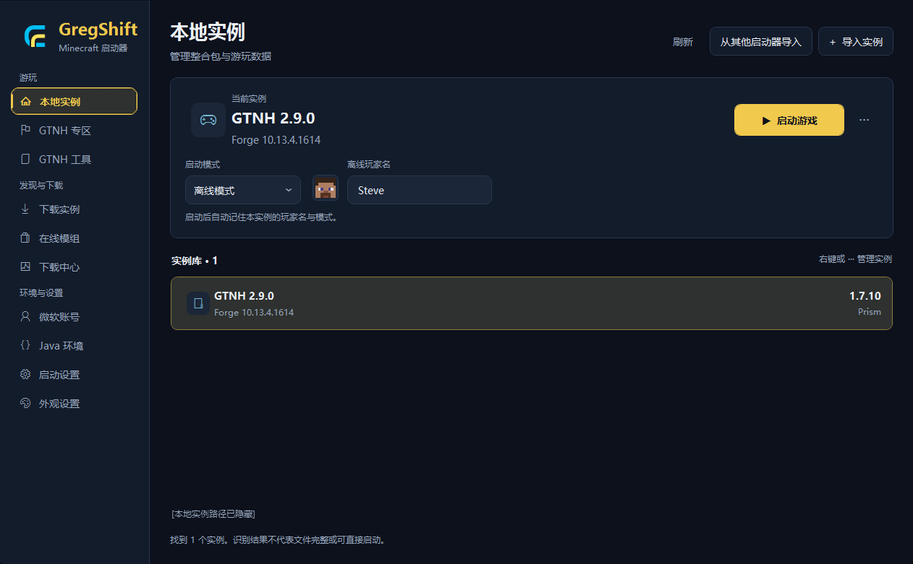
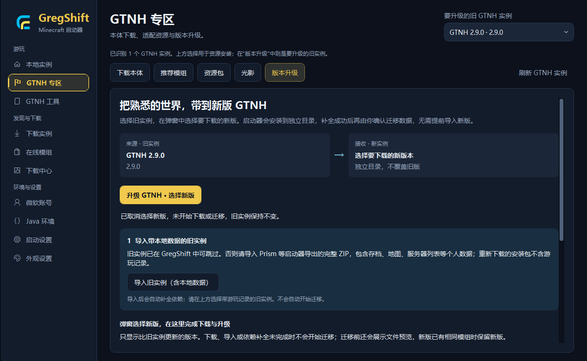
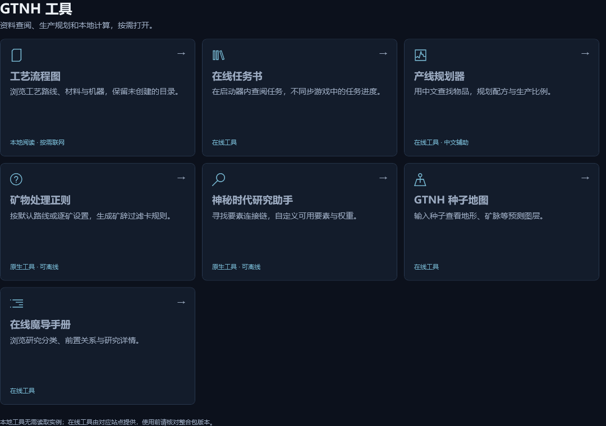
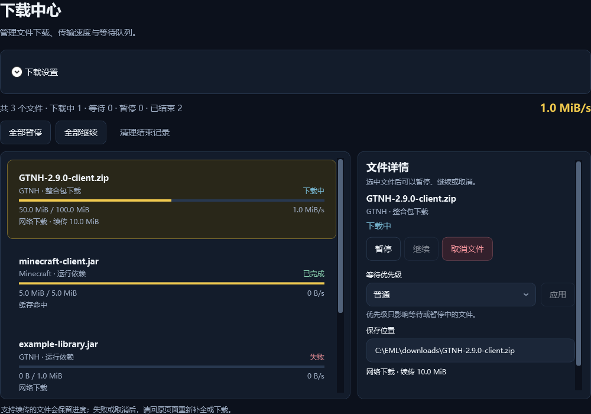
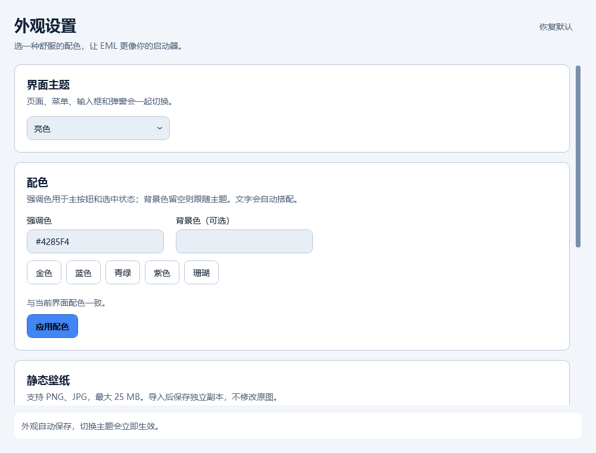

# GregShift

**为国内 GT New Horizons（GTNH）玩家做的 Windows 启动器。**

简体中文 | [English](README.en.md) · [下载测试版](https://github.com/Ph1lK4/GregShift/releases) · [使用文档](#使用文档) · [反馈问题](https://github.com/Ph1lK4/GregShift/issues)

GTNH 往往一玩就是很久。整合包更新了，存档、地图和个人设置却还在旧实例里。GregShift 想把安装、游玩和更新接起来：下载整合包、准备 Java、启动游戏，再把熟悉的世界带到新版，不用每次对着文件夹重新搬一遍。

项目原名 EML，由 K4ssia 个人维护，也支持其他常见整合包及 Minecraft Java 版原版。**这是第三方项目，并非 GTNH、Mojang 或 Microsoft 官方启动器。**

> 当前版本为 **1.0-RC3 候选测试版，尚未签名**，不是正式版。下载和使用前请阅读 [RC3 发布说明](docs/release-rc3.md)，首次测试或升级前请备份存档。旧 RC2 下载与校验值保留，不包含本文介绍的全部新功能。

## 界面预览

本地实例、GTNH 推荐模组与版本升级为实际运行截图，本机路径已遮挡；工具目录、下载中心和亮色外观使用当前源码的真实界面控件与演示数据离屏渲染。截图不代表在线服务或游戏已通过完整验收，界面目前以中文为主。

GTNH 推荐模组、版本升级与工具目录

按分类和规则分组浏览推荐模组，安装前核对目标版本、Java 和前置依赖。

从旧实例开始，在独立弹窗中选择要下载的新版，不必提前安装两个版本。

七项 GTNH 工具集中在独立页面，查资料和使用本地工具都不需要先选择实例。

下载中心与亮色外观

## GTNH：安装、游玩，再升级

### 下载与可添加内容

在 GTNH 专区选择国内镜像提供的具体版本，下载 Prism / MultiMC 客户端包并导入。已有实例也可以从其他启动器的受支持目录直接复制过来，不用先打 ZIP，原实例会保留。

专区还整理了可添加模组、资源包、光影和加载器，提供中文介绍、作者来源、分类和风险提示。支持的项目可以选择具体发行文件后安装；Modernity 主资源包、浅色界面与深色界面各有独立入口。非星门规则模组会明确标注，推荐目录不等于兼容保证，也不自动补齐这些项目的前置依赖。

### 从旧实例升级

进入 **GTNH 专区 → 版本升级**，选择有游玩数据的旧实例：

1. 点击“升级 GTNH · 选择新版”，在独立弹窗中选择更高版本和 Java 变体。
2. 确认后在原页面完成下载、导入和依赖补全，创建**独立的新实例**；不会覆盖旧版。已有本地新版也可直接选择。
3. 先试运行新版并正常退出，关闭新旧实例的游戏，再选择需要迁移的数据。
4. 核对文件预览、冲突和兼容提醒，确认后复制。迁移完成后仍需进入游戏验证。

可选择存档、NEI 记录、JourneyMap 地图、矿脉与神秘节点数据、服务器列表及部分个人设置，也提供服务器玩家的客户端数据预设。旧实例还在其他启动器中时，可用“导入旧实例（含本地数据）”先导入；重新下载原始安装包不会带回游玩记录。

**额外模组可以一起迁移，但默认不选。** 页面区分有安装记录与来源待确认的文件，需要用户选择并确认兼容风险。所选旧模组按原文件复制，不自动升级、不补前置；新版已有的重复模组保留新版，不把旧版独有的所有模组都认作玩家新增。

旧实例的游戏文件保持不动；修改目标前先备份，同名世界另存而非合并。满足恢复条件时可恢复上次迁移，但不会强行覆盖迁移后的新进度。

**迁移的是玩家数据和语言偏好，不是旧汉化包、整包配置或配方脚本；目前不含服务端升级或 SFTP 迁移。** 文件复制成功不代表存档和模组兼容。跨大版本请遵循 GTNH 的更新建议，必要时逐版本升级，并保留独立备份。

详见 [专区说明](docs/gtnh-hub.md)和 [玩家数据迁移指南](docs/gtnh-player-data-migration.md)。

## GTNH 工具

入口位于左侧“GTNH 专区”下方，无需绑定实例。

| 工具 | 可以做什么 | 运行方式 |
| --- | --- | --- |
| 工艺流程图 | 搜索目录、缩放与拖动画布，查看物品图标、动态图集和悬停配方卡片；未创建条目保留并标注 | 本机画布，按需联网，已缓存内容可离线查看 |
| 在线任务书 | 在启动器内查任务、搜索和选择资料版本，不同步游戏进度 | 内置浏览器，需联网 |
| 产线规划器 | GTNH Planner 中文辅助、顶部中文物品搜索、方案 JSON 导入与导出 | 内置浏览器，需联网 |
| 矿物处理正则 | 按处理路线与矿物生成过滤卡规则，复制结果、保存方案 | 原生计算，可离线使用 |
| 神秘时代研究助手 | 查找要素连接链，调整可用要素与权重 | 原生计算，可离线使用 |
| GTNH 种子地图 | 手动输入种子，查看原站提供的地形与矿脉等图层 | 内置浏览器，需联网 |
| 在线魔导手册 | 聚焦研究目录和交互研究图，保留搜索、分类与详情 | 内置浏览器，需联网 |

流程图只使用原页面提供的图表与配方资料，不根据连线虚构配方，也不是完整配方数据库；网络或验证限制可能影响首次读取。研究助手查连接链，不求解整张研究笔记。工具资料请核对适用的 GTNH 版本。

网页工具需要 **Microsoft Edge WebView2 Evergreen Runtime**，它不包含在启动器自带的 .NET 中。Planner 中文搜索请用启动器顶部的搜索框，未收录的文字仍显示原文。重要方案请主动导出，**`planner-webview2` 中的方案不能当普通缓存随意清理**。

详见 [GTNH 工具说明](docs/gtnh-tools.md)、[原生工具与数据来源](docs/gtnh-native-tools.md)和 [Planner 来源与许可](docs/gtnh-planner-notices.md)。第三方网页、图表、词典和图片仍适用各自许可，不随启动器源码改用 GPL。

## 其他日常功能

- **安装实例**：下载 Modrinth、CurseForge 整合包及 Mojang 原版；导入 Prism ZIP、`.mrpack`、CurseForge ZIP 和支持的通用 ZIP，复制导入 Prism、Modrinth App 等受支持实例目录。导入后自动补全受支持的文件与运行依赖。
- **账号与启动**：管理多个微软正版账号或使用离线玩家名；按实例记住上次启动身份和模式，显示皮肤头像或 Steve。正版认证失败不会静默切成离线模式。Java、内存和 JVM 参数按实例设置。
- **Java 环境**：检测本机 Java，也可下载适配版本；启动时缺少兼容 Java 会先询问，不擅自修改系统环境。
- **模组管理**：在线搜索、按版本与加载器筛选、独立详情页；通用在线安装可选择自动加入必要依赖及勾选可选依赖。本地额外模组支持启禁、回收与恢复，原包模组受保护。
- **下载中心**：查看任务和速度，暂停、继续、取消，设置并发、队列优先级与总限速；校验后复用缓存，在满足条件时断点续传。不代表重启后会自动恢复整项安装。
- **实例维护**：右键实例或点击“···”查看详情、文件检查、补全、日志和 ZIP 备份等。校验区分文件来源与已接受的用户变更，日常启动不重复计算整包哈希。
- **外观**：暗色、亮色、跟随系统，自定义配色与静态壁纸；轻量交互动画尊重系统动画和高对比度设置。初始化扫描只更新页面状态，不弹结果窗口。

## 开始使用

发布包面向 **Windows x64**，自带启动器所需 .NET，不需要 Visual Studio 或 .NET SDK。Java 和游戏另行准备。

1. 从 [GitHub Releases](https://github.com/Ph1lK4/GregShift/releases) 下载测试包，完整解压到有写入权限的目录，运行根目录 **`EML.exe`**。不要在压缩软件中运行，也不要只复制 EXE 或移除 `app/`。
2. 在 GTNH 专区下载本体，或下载、导入其他实例。等待依赖补全结束，按提示处理仍缺少的文件。
3. 检测或下载 Java；需要正版启动时先登录微软账号。在启动设置中核对身份、Java 和内存，保存参数后启动。
4. 首次使用、更新或迁移先用存档副本测试；出现问题时查看结果说明和本次运行日志。

更名为 GregShift 不会移动原 EML 数据，部分程序名和路径仍沿用 EML。升级启动器前先关闭游戏和所有任务，按 [RC3 发布与升级指南](docs/release-rc3.md)保留数据，**不要清空旧目录再解压**。实例 ZIP 不包含实例外的共享运行依赖、账号凭证或完整迁移备份，不能代替整个数据目录的备份。

## 使用前需要知道

- **仍需实际验收**：自动化测试不能覆盖所有电脑、网络、整合包和服务器。干净电脑、真实多账号与完整端到端场景仍需测试，不承诺所有实例都可启动。
- **受限文件可能要手动处理**：CurseForge 无直接下载时，只尝试相同官方 SHA-1 与大小的 Modrinth 文件，不按相似名称替换，也不关闭完整性校验。并非所有 ZIP 或加载器都支持自动补全。
- **镜像不是官方完整性证明**：GTNH 镜像包检查大小、格式与路径；当前没有官方哈希验证，本地缓存摘要不等于官方认证。
- **中文内容并非全量翻译**：常见模组有内置中文名和简述；整合包保留平台 API 提供的中文或原文，不自动翻译所有介绍。
- **离线不替代正版认证**：正版启动及正版服务器需要相应游戏许可、服务权限和网络。添加模组、资源包或光影仍应核对服务器规则，资源包与光影安装后需在游戏内启用。
- **当前包未签名**：CI 构建、校验值和 GitHub 发布页都不是 Windows 代码签名或安全认证。若安全软件拦截，请先核对来源和提示，不要关闭防护强行运行。

## 使用文档

- GTNH：[专区与推荐内容](docs/gtnh-hub.md) · [版本升级与数据迁移](docs/gtnh-player-data-migration.md) · [工具](docs/gtnh-tools.md) · [原生工具](docs/gtnh-native-tools.md)
- 安装：[下载实例](docs/instance-downloads.md) · [文件夹导入](docs/folder-import.md) · [Java 下载](docs/java-downloads.md) · [下载中心](docs/download-center.md)
- 游玩：[微软账号](docs/microsoft-login.md) · [启动设置与日志](docs/launching.md) · [在线模组](docs/online-mod-management.md) · [本地模组](docs/local-mod-management.md)
- 维护：[外观设置](docs/appearance.md) · [文件变化与完整性](docs/gameplay-file-policy.md) · [备份与恢复边界](docs/instance-backups.md) · [升级发布包](docs/release-rc3.md) · [卸载与保留数据](docs/uninstall.md)

## 反馈、隐私与安全

维护者：**K4ssia**。普通问题可在 [GitHub Issues](https://github.com/Ph1lK4/GregShift/issues)反馈；联系、隐私问题与安全漏洞私报邮箱：**[477619464@qq.com](mailto:477619464@qq.com)**。

反馈请带上启动器版本、整合包与 Java 版本、复现步骤及必要的错误信息。先脱敏日志，不要公开令牌、账号文件、服务器私人信息或完整实例。安全漏洞请私下报告。

设置、实例和登录记录保存在本机；登录、搜索、头像、下载及在线工具仍会访问第三方服务。微软凭证使用 Windows 当前用户 DPAPI 加密，不能据此认为同一用户下的恶意程序无法访问。当前没有维护者自建的数据接收服务。

[隐私说明](PRIVACY.md) · [安全报告](SECURITY.md) · [代码签名政策](docs/code-signing.md) · [卸载说明](docs/uninstall.md)

## 许可证与致谢

GregShift 采用 **GPL-3.0-or-later**，见 [LICENSE](LICENSE)。Minecraft、整合包、模组、资源包、Java 及其他第三方内容保留各自许可和使用条款。

感谢 GTNH、GTNH 中文维基及社区资料作者，以及提供下载、工具和开源组件的项目维护者。GregShift 只是把这些入口和本地管理流程接起来，原作品的署名和许可仍属于各自作者。
