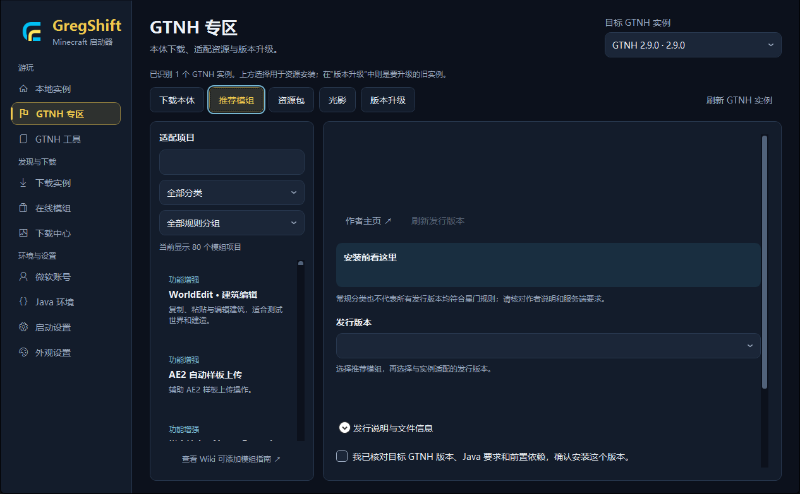

# GregShift

简体中文 | [English](README.en.md)

**面向中国 GT New Horizons（GTNH）玩家的 Windows 启动器。**

GregShift（原 EML）主要为国内 GTNH 玩家开发。GTNH 的一次游玩往往会跨越多个版本，我们希望从安装到更新都能少一些手动操作：下载整合包、准备 Java、管理模组，以及把旧实例里的存档、地图和个人设置迁到新版。

除了 GTNH，也支持常见整合包格式，以及 Modrinth、CurseForge 整合包和 Minecraft Java 版原版的下载安装。项目为个人维护的第三方启动器，**并非 GTNH、Mojang 或 Microsoft 官方项目**。

目前仍处于 **1.0-RC2 测试阶段**，尚未完成全部环境验收。本文介绍当前源码，已发布的 RC2 测试包可能不包含后续改动，请以对应包的发布说明为准。使用与升级说明见 [RC2 发布指南](docs/release-rc2.md)。

更名不改变现有数据位置：发布包仍从根目录的 `EML.exe` 启动，程序与运行库放在 `app/`，实例和设置仍保存在原位置；代码项目名与部分路径暂时沿用 EML。

## 界面预览

以下截图来自较早的中文测试构建，可能与当前界面略有差异；个人信息已作遮挡。

GTNH 专区：推荐模组

GTNH 玩家数据迁移引导

## 主要功能

### 安装与启动

- 从 Modrinth、CurseForge 下载整合包，或安装 Mojang 提供的 Minecraft Java 版原版。
- 导入 Prism ZIP、Modrinth `.mrpack`、CurseForge ZIP 和支持的通用游戏目录 ZIP，导入后自动补全模组及受支持的运行依赖。
- 从 Prism、Modrinth App 等启动器的受支持实例目录直接复制导入，无需先压缩；保留原实例，不搬运原启动器的账号凭证。
- 检测本机 Java，也可在启动器内下载安装。启动前缺少兼容 Java 时，先询问是否下载，不擅自更改系统环境。
- 管理多个微软正版账号，在本地实例和启动设置中选择账号或离线模式。游戏进程启动后，按实例记住本次账号、玩家名和模式；换默认账号不会覆盖实例已有选择，认证失败不会自动换号或转为离线。
- 正版模式显示所选账号的 Minecraft 玩家名与皮肤头像；离线模式输入玩家名，显示内置 Steve 头像。头像加载失败不影响登录或启动。
- 按实例设置 Java、内存和 JVM 参数，并查看运行日志。Java 和 JVM 等参数需手动保存。

### GTNH 专区

- 从已接入的国内镜像选择具体版本的 Prism / MultiMC 客户端包，下载、导入并补全。
- 按类别浏览可添加模组、资源包、光影及加载器，查看中文说明、作者来源和兼容提醒；选择适配版本后安装支持的发行文件。
- 从有本地数据的旧实例发起版本升级，选择新版下载、导入并补全，再确认迁移玩家数据和可选额外模组；无需预先准备本地新版，具体流程见下文。

### GTNH 工具

- 左侧“GTNH 专区”下方提供独立工具页。工艺流程图按目录搜索，点击进入详情；返回时保留筛选和浏览位置，未创建的条目显示“未创建，等待更新”。
- 流程图按需读取原站声明式数据，由本机交互画布绘制，支持缩放、拖动、分组高亮和原站提供的中英文切换。成功缓存后可离线查看；缓存保留来源、修订号（如有）、读取时间和许可信息，不包含原站图标或详细配方弹窗。
- 若原站拒绝直接读取，可在启动器内查看原站，待页面正常显示后主动“读取为本地图表”；数据仍经过相同校验再缓存，不绕过站点访问限制。
- 在线任务书仍在启动器内加载原网页，不读取或同步游戏任务进度。任务书、目录联网更新和显式查看原站需要网络及 WebView2；本地图表不依赖它。图表数据适用原作者许可，详见 [GTNH 工具说明](docs/gtnh-tools.md)。

### 模组与内容管理

- 在线搜索 Modrinth、CurseForge 模组，按游戏版本和加载器筛选，查看图标、简介和发行版本。模组与整合包均从结果列表进入独立详情页，返回时保留筛选条件和浏览位置。
- 通用在线模组安装支持选择是否自动加入必要依赖、勾选可选依赖，并在下载前预览清单。
- 对用户添加或明确接管的额外模组进行启用、禁用、移入回收区和恢复；原包模组不会被默认当作可随意修改的额外文件。

### 下载与实例维护

- 下载中心统一展示文件任务，支持暂停、继续、取消、并发数、优先级和总限速；复用经过校验的缓存，并在满足续传条件时恢复部分下载。
- 在下载设置中查看缓存用量，确认后清理未被占用的完整缓存与诊断副本；手动清理保留续传片段，不删除实例、原始整合包或备份。
- 管理本地实例，查看详情、重命名、删除或导出 ZIP 备份。实例操作集中在右键菜单和启动按钮旁的“···”中。
- 提供文件检查与缺失补全，区分原始来源、用户确认的替换及允许变化的玩家数据，保留已记录的模组启禁和移除选择。日常启动不重复执行整包哈希检查。

### 界面与外观

- 支持暗色、亮色与跟随 Windows 主题，可自定义强调色和背景色。
- 支持本机 PNG、JPG/JPEG 静态壁纸及遮罩调整，不支持视频背景；输入框、菜单和弹窗保持实色，兼顾文字可读性。
- 按钮悬停、按压、导航切换和页面进入有轻量动画，并尊重 Windows 的关闭动画及高对比度设置。初始化检测只更新页面状态，不弹出结果窗口。

设置在本机保存，详见 [外观设置](docs/appearance.md)。目前主要提供中文界面，英文 README 不代表已实现完整英文 UI。

## GTNH 更新与玩家数据迁移

在“GTNH 专区 → 版本升级”选择**带有游玩数据的旧实例**，即可开始准备新版，不必事先拥有两个本地实例。

1. 旧实例还在其他启动器中时，可先通过“从其他启动器导入”复制受支持的实例目录；也可导出包含本地数据的完整实例包，再通过 GTNH 专区的“导入旧实例（含本地数据）”导入。重新下载整合包安装包不会带回你的游玩记录。
2. 点击“升级 GTNH · 选择新版”，在独立弹窗中选择更高版本的 Prism 客户端和 Java 变体，可按需显示测试版。确认后留在升级页下载、导入并补全到**独立的新实例**；关闭或取消弹窗不会开始下载。若已准备好新版，也可使用本地新版入口。
3. 新版补全后先试运行并正常退出。关闭双方游戏，再“继续升级 · 选择数据”，核对预览与冲突提示后迁移。可选内容包括存档、NEI 记录、JourneyMap 地图、矿脉与节点数据、部分个人设置、服务器列表和语言偏好；也有面向服务器玩家的客户端数据预设。

额外模组区分有安装／迁入记录与来源待确认，全部默认不选，需要逐项选择并接受兼容风险。Prism 包内已有文件不会自动视为玩家新增，新版已包含的重复模组会保留新版。迁移只复制所选旧模组，不自动更新或补前置。旧实例的游戏文件不改写；目标原件先备份，同名世界另存。支持恢复上次迁移，但不会覆盖迁移后的新进度。

**此功能升级 GTNH 客户端并迁移所选数据，不升级服务端，也不搬运或安装旧版完整汉化包。** 中文语言偏好可以保留，汉化内容需要适配新版。完成表示“数据迁移完成，待试运行”，不是存档或模组兼容保证；版本跨度较大时，应遵循 GTNH 的逐版本更新建议并验证存档。

完整范围、备份和恢复步骤见 [GTNH 玩家数据迁移指南](docs/gtnh-player-data-migration.md)。

## 开始使用

发布包面向 **Windows x64**，自带启动器所需的 .NET 运行时，不需要安装 Visual Studio 或 .NET SDK；Java 需要另行准备。

1. 将测试包完整解压到自己有写入权限的目录，运行根目录的 `EML.exe`。不要在压缩软件中直接运行，也不要只复制 EXE。
2. 在“GTNH 专区”下载本体，或通过“下载实例”“导入实例”准备整合包，等待导入和自动补全结束。按结果提示处理仍缺少的文件。
3. 在“Java 环境”检测或下载 Java；需要正版启动时，先到“微软账号”登录。随后在“启动设置”选择身份、Java、内存和 JVM 参数。
4. 返回“本地实例”启动游戏；启动失败时查看原因和运行日志。

升级或卸载前，先结束游戏与启动器任务，将需要保留的数据备份到启动器目录之外。**启动器文件夹里可能有存档、地图和迁移备份，不要直接删除旧目录。** 实例 ZIP 导出不等于整个启动器目录的完整备份。参见 [升级指南](docs/release-rc2.md)和 [卸载与数据保留说明](docs/uninstall.md)。

## 当前状态与限制

- **仍在测试阶段**：已有自动化测试和制包验证，但干净电脑验收尚未完成，也没有覆盖所有整合包、账号和服务器组合。当前测试包未签名，测试边界与验收步骤见 [RC2 发布指南](docs/release-rc2.md)；历史测试记录见 [RC1 验证记录](docs/release-rc1-verification.md)。
- **平台与运行条件**：并非所有 ZIP 或加载器都能自动补全，实例 ZIP 导出也不包含实例目录之外的共享依赖。正版启动需要相应游戏许可、服务权限和网络；离线模式不能替代正版认证。
- **受限下载**：部分 CurseForge 模组没有可用的官方下载地址。GregShift 只尝试使用 SHA-1 和大小一致的 Modrinth 文件，匹配不到时需要手动处理，不按相似名称替换。
- **推荐不等于兼容保证**：GTNH 推荐内容中部分项目只提供作者页面或手动下载入口，其前置依赖目前不自动补齐。资源包与光影安装后还需在游戏内启用。
- **镜像校验**：GTNH 镜像原包当前不提供官方哈希验证，具体检查范围见 [专区说明](docs/gtnh-hub.md)。
- **中文资料**：常见模组有内置中文名和简述；整合包介绍保留平台 API 提供的原文与中文内容，不保证每个项目都有翻译。

## 使用文档

- [GTNH 专区](docs/gtnh-hub.md) · [玩家数据迁移](docs/gtnh-player-data-migration.md) · [GTNH 工具](docs/gtnh-tools.md)
- [下载实例](docs/instance-downloads.md) · [下载中心与缓存](docs/download-center.md)
- [在线模组](docs/online-mod-management.md) · [本地模组管理](docs/local-mod-management.md)
- [Java 下载](docs/java-downloads.md) · [启动设置与日志](docs/launching.md) · [微软账号](docs/microsoft-login.md)
- [外观设置](docs/appearance.md) · [界面与导航](docs/ui-navigation.md)
- [文件完整性与游玩后的变化](docs/gameplay-file-policy.md) · [实例备份与恢复边界](docs/instance-backups.md)
- [从其他启动器复制导入](docs/folder-import.md)
- [RC2 发布与升级](docs/release-rc2.md) · [RC1 历史发布](docs/release-rc1.md) · [RC1 验证记录](docs/release-rc1-verification.md)

## 联系、隐私与安全

维护者：**K4ssia**。一般联系、隐私问题和安全漏洞私报邮箱：[477619464@qq.com](mailto:477619464@qq.com)。

反馈时请提供启动器版本、整合包名称与版本、Java 版本、复现步骤和必要的错误信息。先检查并脱敏日志，不要发送账号文件、令牌、完整私人日志或实例；疑似安全漏洞请私密报告。

实例、设置和账号凭证保存在本机；登录、搜索、皮肤头像、项目图标和下载会访问相应的第三方服务。目前没有维护者自建的数据接收服务，也没有启用捐赠或独立反馈平台。详细说明见 [隐私说明](PRIVACY.md)、[安全报告](SECURITY.md)和 [卸载说明](docs/uninstall.md)；部分文档仍使用旧名称 EML。

## 许可证

GregShift 采用 **GNU General Public License v3.0 或任何后续版本（`GPL-3.0-or-later`）** 发布，全文见 [LICENSE](LICENSE)。Minecraft、整合包、模组、资源包、Java 和其他第三方组件仍适用各自的许可与使用条款。

## 代码签名政策

当前 `1.0-RC2` 包及此前 RC1 包均**未签名**。本次 SignPath Foundation 申请未获批准，尚未接入签名服务。已有 GitHub Actions 构建与测试流程，但它不提供代码签名。

代码审核与签名批准负责人为 **K4ssia**。账号安全配置和拟采用的审批流程见[代码签名政策](docs/code-signing.md)；本文不代表已经通过签名或安全认证。
